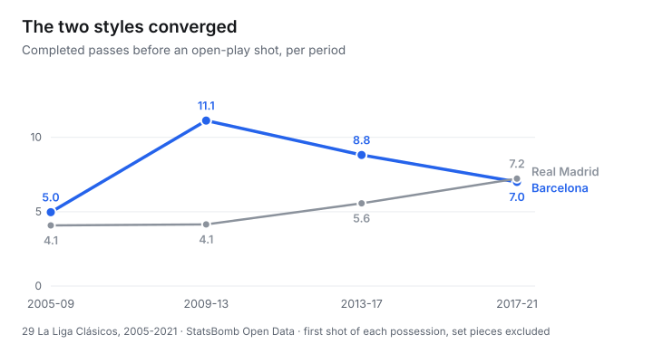
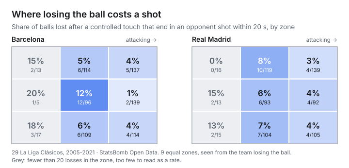

# El Clásico, 2005–2021: how the fixture changed

[](https://github.com/arslannizzetali/el-clasico-analytics/actions/workflows/ci.yml)

A match-by-match tactical analysis of **29 Real Madrid – Barcelona La Liga matches** (November 2005 – April 2021),
built from StatsBomb's free event data. The goal is evidence rather than narrative: every number traces back to
individual events, matches and pitch locations, and every claim comes with how sure we can be about it.

**[Open the interactive dashboard →](https://arslannizzetali.github.io/el-clasico-analytics/)**

Data: [StatsBomb Open Data](https://github.com/statsbomb/open-data), read from the fixed commit
[`4b73468`](https://github.com/statsbomb/open-data/tree/4b73468fc5b0f1950f9f66fada70ad3a4f9327cb) (master on
2026-09-07; see [Data version](#data-version)). These matches are in the open data because
StatsBomb released Lionel Messi's full Barcelona career, so coverage follows Barcelona's league Clásicos.

**Scope.** Every number comes from these 29 matches only. A finding such as "Barcelona pressed less" means *less
against Real Madrid, in Clásicos*; it says nothing about how either team played the rest of La Liga.

## Key findings (in Clásicos only)

| | 2005-09 | 2009-13 | 2013-17 | 2017-21 | Change [90% interval] |
|---|---|---|---|---|---|
| Barcelona: passes before an open-play shot | 5.0 | **11.1** | 8.8 | 7.0 | 2009-13 → 2017-21: −4.1 [−7.8, −0.7] |
| Real Madrid: passes before an open-play shot | **4.1** | 4.1 | 5.6 | **7.2** | 2005-09 → 2017-21: +3.1 [+1.6, +4.4] |
| Barcelona: PPDA (higher = less pressure) | 10.0 | **9.5** | 12.0 | **17.9** | 2009-13 → 2017-21: +8.4 [+6.0, +11.1] |
| Barcelona: balls stripped per 100 opponent controls | 8.6 | **10.1** | 6.3 | **5.0** | 2009-13 → 2017-21: −5.1 [−6.8, −3.5] |
| Real Madrid: press success (%) | 16.8 | **13.6** | 18.7 | **21.4** | 2009-13 → 2017-21: +7.8 [+4.6, +11.3] pts |

**1. In Clásicos, the two styles converged.** By period, Barcelona's build-up against Real Madrid peaked in 2009-13
(11.1 passes before a shot) and fell to 7; Real Madrid's against Barcelona went from direct play (4) to 7. Real
Madrid's rise passes both the 90% and the stricter 99% check; Barcelona's fall passes only the 90% one (99% interval
−10.0 to +1.1), so treat it as likely rather than sure. The 2009-13 peak is **not** a Guardiola peak, though: grouped by coach (below), Guardiola's Clásicos average 8.9 passes, the same as Luis
Enrique's 8.7, and the period figure is lifted by Vilanova's two matches (13.9).

### By Barcelona coach

The four-season periods do not follow coaching changes: Guardiola's first two Clásicos (2008-12-13, 2009-05-02) fall in
2005-09 and Vilanova's two in 2009-13. The dashboard can therefore group the same matches by Barcelona's coach on
the day (Real Madrid's numbers are grouped the same way, so both teams can be compared within a Barcelona coach).

| Barcelona | Rijkaard (4) | Guardiola (8) | Vilanova (2) | Martino (2) | Luis Enrique (6) | Valverde (4) | Setién (1) | Koeman (2) |
|---|---|---|---|---|---|---|---|---|
| Passes before an open-play shot | 4.8 | 8.9 | *13.9* | *9.3* | 8.7 | 7.4 | *7.6* | *6.1* |
| PPDA (higher = less pressure) | 10.3 | **9.6** | *9.3* | *10.9* | 12.4 | 20.4 | *13.8* | *16.2* |
| Balls stripped per 100 opponent controls | 7.4 | **10.8** | *9.2* | *6.9* | 6.2 | 4.9 | *5.4* | *5.1* |
| Press success (%) | 19.8 | **30.5** | *26.9* | *24.5* | 20.9 | 19.0 | *17.6* | *25.5* |

Matches in brackets. *Italics*: fewer than 4 matches, shown but given no interval and left out of every comparison.

**How small coaches are handled.** A coach needs at least 4 Clásicos to get a bootstrap interval and to enter the
change tests; that leaves Rijkaard, Guardiola, Luis Enrique and Valverde. With one or two matches a resample can only
repeat those same matches, so the "interval" would just be the spread of two numbers, and Setién's single match has no
spread at all. They are not merged into a neighbour either: Vilanova with Guardiola, say, would be defensible on
continuity but would quietly decide the very question the grouping is meant to test. Their averages are shown,
marked, and left out of claims.

**What survives the regrouping.** In Clásicos, Guardiola's Barcelona pressed hardest on every pressing measure:
press success 30.5% against 20.9% under Luis Enrique (change −9.6 [−12.7, −6.5] points) and 19.0% under Valverde;
balls stripped 10.8 per 100 against 6.2 and 4.9; PPDA 9.6 against 12.4 and 20.4. The build-up claim does not
survive: Guardiola 8.9 [6.3, 11.6] against Luis Enrique 8.7 [7.6, 9.9], change −0.2 [−3.2, +2.6]. What the coach
view does show is that Barcelona's build-up against Real Madrid lengthened after Rijkaard (4.8 → 8.9, change +4.1 [+1.1, +7.0]).



**2. Barcelona's press against Real Madrid faded, and the scoreline does not explain it.** With the score level,
Barcelona's PPDA in Clásicos went from 8.4
(2009-13) to 19.9 (2017-21), change +11.4 [+8.0, +15.9]. In 2017-21 Barcelona led for only 20% of the minutes,
so "they sat back while winning" is not the reason. Press success and balls stripped fell the same way. Real Madrid's
press against Barcelona, meanwhile, became more effective.


**3. In Clásicos, losing the ball in midfield is what hurts.** Barcelona's central-midfield losses (zone 5) end in a Real Madrid shot
12.5% of the time, against 1–4% in the attacking third, although most of those shots come from distance. Only 1 of
Barcelona's 744 losses after a controlled touch led to a goal within 20 seconds; Real Madrid's led to 5.



### How sure are these numbers?

Each period average rests on only 6–8 matches (each coach average on 4–8), so every average in the dashboard carries a **90% bootstrap
interval**: the period's matches are resampled with replacement 5,000 times and the metric is recomputed from the
resampled totals. The match is the unit of resampling because events within a match are not independent. A change
between periods is called clear only when its interval excludes zero; 56 of the 108 period-to-period changes are.
Example of one that is not: Real Madrid's PPDA with the score level, 2005-09 → 2017-21, +0.4 [−2.7, +3.2].

**Many tests, some false alarms.** 108 changes are tested per grouping. At a 90% interval roughly 1 in 10 would look
clear by chance even if nothing had changed at all, so about **11 of the 56** clear period changes could be noise
(the tests share matches and are not independent, so this is a rough guide, not an exact count). Each change
therefore also carries a 99% interval (`lo99`, `hi99` in `uncertainty.json`) and `clear_strict = 1` when that too
excludes zero; by chance alone about 1 of 108 would. **31 of the 108 period changes pass the strict threshold**, and
31 of the 108 coach-to-coach changes. All headline changes in the table above pass it except Barcelona's passes before
a shot, 2009-13 → 2017-21 (99% interval −10.0 to +1.1). Of the coach comparisons quoted above, Guardiola's higher
press success and balls stripped against Luis Enrique and Valverde, and his lower PPDA against Valverde, pass; his
lower PPDA against Luis Enrique (+2.9; 99% −1.1 to +8.2) and the longer build-up after Rijkaard (+4.1; 99% −0.2 to
+8.9) do not.

**Does one match drive an average? (leave-one-out)** Every average with an interval is recomputed with each of its
matches dropped in turn; `uncertainty.json` stores the lowest and highest result (`loo_lo`, `loo_hi`), the match
whose removal moves it most (`loo_date`), and `single_match = 1` when that move exceeds 20%. The same is done for
every change, over the matches of both groups (`loo_flip = 1` if one match can zero or reverse it). Because each
average is a ratio of totals, a match with a tiny denominator carries little weight: 2013-03-02 (2 shots, 33 passes
each) and 2010-04-10 (2 shots) barely move Barcelona's 2009-13 passes before a shot, 11.1 (10.1–12.3 without any one
match). The headline changes hold up the same way:

| Change | Estimate | Without any one match |
|---|---|---|
| Barcelona passes before a shot, 2009-13 → 2017-21 | −4.1 | −5.3 to −3.1 |
| Real Madrid passes before a shot, 2005-09 → 2017-21 | +3.1 | +2.7 to +3.5 |
| Barcelona PPDA, 2009-13 → 2017-21 | +8.4 | +7.4 to +9.2 |
| Barcelona PPDA with the score level, 2009-13 → 2017-21 | +11.4 | +9.8 to +12.8 |
| Barcelona balls stripped per 100, 2009-13 → 2017-21 | −5.1 | −5.8 to −4.7 |
| Real Madrid press success, 2009-13 → 2017-21 | +7.8 | +6.4 to +8.7 pts |

None of the clear changes, by period or by coach, is reversed or brought to zero by dropping a single match. Where
one match **does** move an average by more than 20%, read that average with care (marked * on the dashboard):

- 2005-09, score level: Barcelona passes before a shot (5.3; 4.1–5.9), press success (28.3%; 19.7–29.8) and balls
  stripped (8.8; 5.5–10.8) all hinge on **2008-12-13**, Guardiola's first Clásico, the match the period grouping puts
  in the wrong era. Real Madrid passes before a shot (4.0; 3.1–5.0) hinges on 2007-03-10.
- 2005-09, all minutes: Barcelona quick shots conceded after a turnover (7.4%; 5.5–8.7), 2006-10-22.
- By coach, 13 averages, mostly with the score level and mostly the 4-match groups (Rijkaard, Valverde): e.g.
  Barcelona passes before a shot with the score level under Rijkaard 4.7 (2.7–6.7) and Valverde 8.1 (6.0–10.9), and
  under Guardiola 9.1 (7.8–11.5, again 2008-12-13). The full list is in `uncertainty.json` and on the dashboard.

## Interactive dashboard

The [dashboard](https://arslannizzetali.github.io/el-clasico-analytics/) is a single static file
([`docs/index.html`](docs/index.html)): pick a team and a metric, see every match as a point and every period as an
average with its interval, split pressing and build-up metrics by score state, click a pitch zone to list the losses
behind it, and open a match report with both teams against their period average. Light and dark mode, works on a phone.

It runs exactly the same page code as the working dashboard; `site/build_site.py` embeds the processed data and a
small stand-in for the dashboard API, so the two versions cannot drift apart.

## How the metrics are measured

| Metric | Definition |
|---|---|
| Passes before a shot | Completed passes by the shooting team in the possession before its **first** open-play shot (penalties, corners and free kicks excluded). Later shots in the same possession are listed but not counted, so passes are not double-counted. |
| Quick shot after turnover | Share of open-play turnovers followed by an opponent shot within 15 s. |
| Regain within 8 s | Share of turnovers won back within 8 s. |
| Press success | Share of a team's pressures followed by its own possession within 5 s. |
| PPDA | Opponent passes in their own build-up zone (x ≤ 72) per defensive action (tackle, interception, foul) at x ≥ 48. |
| Ball stripped | A player completes a ball receipt and loses it before releasing it (Dispossessed, Miscontrol or failed dribble, within 12 s), per 100 opponent controls. |
| Players pressing | Distinct opponents with a pressure event within ~11 m of the ball between receipt and loss. Off-ball positions are not in event data, so this is a lower bound. |
| Game state | Every event is labelled Ahead / Level / Behind from goals scored *before* it (penalties and own goals included). Metrics are re-aggregated by state; the three states always sum to the match totals. |
| Pitch zones | 9 equal zones (3 × 3, 40 × 26.7 units) from the view of the team losing the ball, attacking left to right: 1-3 own third, 4-6 middle third, 7-9 attacking third. |

## Project layout

```
clasico/            shared definitions (one place for every rule)
  data.py           download with retries + local cache (data/raw)
  events.py         time, ball-strip detection, possessions, zones, game state
  output.py         JSON/CSV writing; each JSON carries the code that produced it
scripts/            pipeline steps, run in this order by pipeline.py
  build.py          match-team metrics + every non-penalty shot
  losses.py         every ball lost after a controlled touch, with the opponent shot that followed
  strips.py         players pressing each loss
  game_state.py     main metrics split by Ahead / Level / Behind
  uncertainty.py    bootstrap intervals for period averages and period-to-period changes
  loss_table.py     flat loss table (CSV) for spreadsheet use
site/               build_site.py (static dashboard -> docs/index.html), readme_charts.py (docs/img/*.svg)
docs/               published site: index.html + README charts
tests/              unit tests on hand-built events + consistency tests on outputs
data/processed/     outputs (data/raw is downloaded and not committed)
dashboard/          dashboard page source
.github/workflows/  CI: tests, freshness of generated files, full rebuild from raw data
```

## Run it

Python 3.10+ and the standard library only; nothing to install.

```bash
python3 pipeline.py                      # downloads the data on first run, then ~40 s
python3 -m unittest discover -s tests    # 21 tests
python3 site/build_site.py               # rebuild docs/index.html
python3 site/readme_charts.py            # rebuild the README charts
```

The tests check the definitions on small synthetic event sequences (what counts as a strip, how the score state is
assigned around a goal, zone edges) and the outputs against each other: 29 matches, mirrored scores, game-state
splits summing to match totals, loss and strip tables lining up row by row, intervals containing their estimates.

CI runs on every push: the tests; a check that the site and charts are up to date with the data; and a full rebuild
from raw StatsBomb data that must reproduce every committed output byte for byte (the bootstrap uses a fixed seed).

## Data version

The raw files are downloaded from one pinned commit of `statsbomb/open-data`, set once as `STATSBOMB_SHA` in
[`clasico/data.py`](clasico/data.py). Reading from `master` would let any later correction by StatsBomb change the
outputs and break CI's byte-for-byte rebuild without a change in this repository. To move to newer data:

1. Set `STATSBOMB_SHA` to the new commit (`git ls-remote https://github.com/statsbomb/open-data refs/heads/master`).
2. Delete `data/raw` and run `python3 pipeline.py`, then `site/build_site.py` and `site/readme_charts.py`.
3. Review the changed numbers, update the README text where they moved, and commit `data/processed` and `docs/`.

CI's raw-data cache key contains the SHA, so the new commit is downloaded fresh.

## Credits

Event data © StatsBomb, released as open data under their
[user agreement](https://github.com/statsbomb/open-data/blob/master/LICENSE.pdf).
