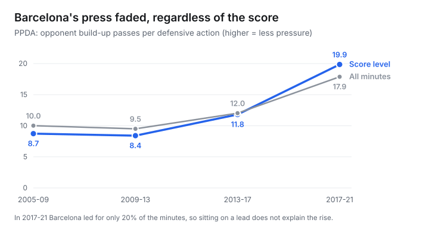

# El Clásico, 2005–2021: how the game changed

A match-by-match tactical analysis of **29 Real Madrid – Barcelona La Liga matches** (November 2005 – April 2021),
built from StatsBomb's free event data. The goal is not general statements about "tiki-taka" but evidence:
every number traces back to individual events, matches and pitch locations.

Data: [StatsBomb Open Data](https://github.com/statsbomb/open-data). These matches are in the open data because
StatsBomb released Lionel Messi's full Barcelona career, so coverage follows Barcelona's league Clásicos.

## Key findings


| | 2005-09 | 2009-13 | 2013-17 | 2017-21 |
|---|---|---|---|---|
| Barcelona: completed passes before an open-play shot | 5.0 | **11.1** | 8.8 | 7.0 |
| Real Madrid: completed passes before an open-play shot | **4.1** | 4.1 | 5.6 | **7.2** |
| Barcelona: PPDA (lower = more intense press) | 10.0 | **9.5** | 12.0 | **17.9** |
| Barcelona: balls won off the receiver per 100 opponent controls | 8.6 | **10.1** | 6.3 | **5.0** |

- **The two styles converged.** Barcelona's build-up peaked under Guardiola (~11 passes per shot) and fell to ~7;
  Real Madrid went from direct play (~4) to ~7.


- **Barcelona's press faded, and not because of the scoreline.** With the score level, PPDA went from 8.4 (2009-13)
  to 19.9 (2017-21). In 2017-21 Barcelona led for only 20% of the minutes, so "they sat back while winning" does not explain it.
- **Real Madrid's press became more effective** (pressures regaining the ball within 5 s: 13.6% → 21.4%).


- **Losing the ball in midfield is what hurts.** About half of all losses happen in the opponent's half, but
  Barcelona's central-midfield losses (zone 5) end in an opponent shot 12.5% of the time, versus 1–4% in the
  attacking third. Only 1 of Barcelona's 744 losses after a controlled touch led to a goal within 20 s; Real Madrid's led to 5.

Samples are small (6–8 matches per period, a few dozen shots per cell). Treat percentages as direction, not precision;
the dashboard marks values that rest on very few events.

## Interactive dashboard

[`docs/index.html`](docs/index.html) is the full dashboard as a single file (published with GitHub Pages):
pick a team and a metric, see every match as a point and every period as an average, split any pressing or
build-up metric by score state, click a pitch zone to list the losses behind it, and open a match report with
both teams' numbers against their period average. Light and dark mode, works on a phone.

It runs exactly the same page code as the working dashboard; `site/build_site.py` embeds the processed data and
a small stand-in for the dashboard API, so the two versions cannot drift apart.

## How the metrics are measured

| Metric | Definition |
|---|---|
| Passes before shot | Completed passes by the shooting team in the possession before its **first** open-play shot (penalties, corners and free kicks excluded). Later shots in the same possession are listed but not counted, so passes are not double-counted. |
| Quick shot after turnover | Share of open-play turnovers followed by an opponent shot within 15 s. |
| Regain within 8 s | Share of turnovers won back within 8 s. |
| Press success | Share of a team's pressures followed by its own possession within 5 s. |
| PPDA | Opponent passes in their own build-up zone (x ≤ 72) per defensive action (tackle, interception, foul) at x ≥ 48. |
| Ball stripped | A player completes a ball receipt and then loses it before releasing it (Dispossessed, Miscontrol or failed dribble, within 12 s), per 100 opponent controls. |
| Players pressing | Distinct opponents with a pressure event within ~11 m of the ball between receipt and loss. Off-ball positions are not in event data, so this is a lower bound. |
| Game state | Every event is labelled Ahead / Level / Behind from goals scored *before* it (penalties and own goals included). Metrics are re-aggregated by state; the three states always sum to the match totals. |
| Pitch zones | The pitch is split into 9 equal zones (3 × 3, 40 × 26.7 units) from the perspective of the team losing the ball, attacking left to right: 1-3 own third, 4-6 middle third, 7-9 attacking third. |

## Project layout

```
clasico/            shared definitions (one place for every rule)
  data.py           download with retries + local cache (data/raw)
  events.py         time, ball-strip detection, possessions, zones, game state
  output.py         JSON/CSV writing; each JSON carries the code that produced it
scripts/            pipeline steps
  build.py          match-team metrics + every non-penalty shot
  losses.py         every ball lost after a controlled touch, with the opponent shot that followed
  strips.py         players pressing each loss
  game_state.py     main metrics split by Ahead / Level / Behind
  kayiplar.py       loss table for the spreadsheet view
pipeline.py         runs all steps in order
site/               build_site.py (static dashboard -> docs/index.html), readme_charts.py (docs/img/*.svg)
docs/               published site: index.html + README charts
tests/              unit tests on hand-built events + consistency tests on outputs
data/processed/     outputs (data/raw is downloaded and not committed)
dashboard/          dashboard page source (Turkish UI)
```

## Run it

Python 3.10+ and the standard library only; nothing to install.

```bash
python3 pipeline.py                      # downloads the data on first run (~1 min afterwards)
python3 -m unittest discover -s tests    # 19 tests
python3 site/build_site.py               # rebuild docs/index.html
python3 site/readme_charts.py            # rebuild the README charts
```

The tests check the definitions on small synthetic event sequences (what counts as a strip, how the score state
is assigned around a goal, zone edges) and the outputs against each other: 29 matches, mirrored scores,
game-state splits summing to match totals, loss and strip tables lining up row by row.

## Credits

Event data © StatsBomb, released as open data under their
[user agreement](https://github.com/statsbomb/open-data/blob/master/LICENSE.pdf).
