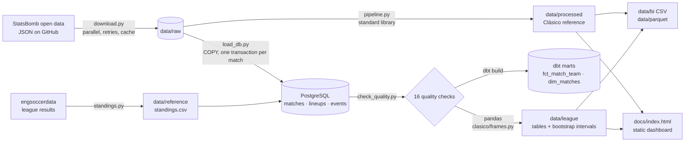

# El Clásico in the Messi era: 29 league Clásicos, 2005–2021

[](https://github.com/arslannizzetali/el-clasico-analytics/actions/workflows/ci.yml)
[](LICENSE)

A match-by-match tactical analysis of **29 Real Madrid – Barcelona La Liga matches** (November 2005 – April 2021),
set against 524 Barcelona league matches, the complete 2015/16 season and 7 Champions League finals, built from
StatsBomb's free event data. Every number traces back to individual events, and every claim comes with how sure we
can be about it.

**[Open the interactive dashboard →](https://arslannizzetali.github.io/el-clasico-analytics/)** ·
**[One-page summary](docs/summary.md)**

<table>
<tr>
<td width="50%" valign="top">

### 📊 [Findings](#findings): the analyst's view

What changed in the Clásico, whether it differs from other matches, and how sure we can be.

- Five findings with 90% bootstrap intervals
- Interactive dashboard with four tabs
- Metric definitions and limitations
- A Power BI / Tableau-ready CSV set

**Start here:** [Key findings](#key-findings-the-clásico) ·
[summary](docs/summary.md) · [BI guide](docs/bi.md)

</td>
<td width="50%" valign="top">

### 🛠️ [Engineering](#engineering): the engineer's view

How 3.1 million events go from raw JSON to tested tables and a static site.

- PostgreSQL event store, idempotent incremental loads
- dbt (staging → intermediate → marts) with tests
- Dagster pipeline with retries; CSV, JSON and Parquet
- 16 data quality checks; outputs reproduced byte for byte in CI

**Start here:** [Architecture](#architecture) ·
[design decisions](#design-decisions) · [tests](#data-quality-and-testing)

</td>
</tr>
</table>

Data: [StatsBomb Open Data](https://github.com/statsbomb/open-data). These matches are in the open data because
StatsBomb released Lionel Messi's full Barcelona career, so coverage follows Barcelona's league Clásicos: it is a
study of these matches in that era, not of how football as a whole changed.

---

## Findings

### Who is this for, and which decision does it serve?

| Audience | Decision it supports | Where to look |
|---|---|---|
| Coaching staff / opposition analysts | How to set up against a possession side: press high or sit deep, where to win the ball, which zones to protect after losing it | Pressing and loss maps (El Clásico tab), opponent explorer and formations (League context) |
| Recruitment / performance department | Did a new coach change how the team plays, and how fast? Which changes are real and which are noise? | Special seasons tab, intervals in every table |
| Broadcasters and club media | Which talking points survive the data ("Barça stopped pressing", "finals are different") and with what caveats | Key findings, [one-page summary](docs/summary.md) |

It is a retrospective study: it explains what happened in these matches and how sure we can be, it does not
predict results or rate individual players.

### Key findings: the Clásico

| | 2005-09 | 2009-13 | 2013-17 | 2017-21 | Change [90% interval] |
|---|---|---|---|---|---|
| Barcelona: passes before an open-play shot | 5.0 | **11.1** | 8.8 | 7.0 | 2009-13 → 2017-21: −4.1 [−7.8, −0.7] |
| Real Madrid: passes before an open-play shot | **4.1** | 4.1 | 5.6 | **7.2** | 2005-09 → 2017-21: +3.1 [+1.6, +4.4] |
| Barcelona: PPDA (higher = less pressure) | 10.0 | **9.5** | 12.0 | **17.9** | 2009-13 → 2017-21: +8.4 [+6.0, +11.1] |
| Barcelona: balls stripped per 100 opponent controls | 8.6 | **10.1** | 6.3 | **5.0** | 2009-13 → 2017-21: −5.1 [−6.8, −3.5] |
| Real Madrid: press success (%) | 16.8 | **13.6** | 18.7 | **21.4** | 2009-13 → 2017-21: +7.8 [+4.6, +11.3] pts |

**1. The two styles converged.** Barcelona's build-up peaked under Guardiola (11 passes before a shot) and fell to 7;
Real Madrid went from direct play (4) to 7. Both changes hold under resampling.


**2. Barcelona's press faded, and the scoreline does not explain it.** With the score level, PPDA went from 8.4
(2009-13) to 19.9 (2017-21), change +11.4 [+8.0, +15.9]. In 2017-21 Barcelona led for only 20% of the minutes,
so "they sat back while winning" is not the reason. Press success and balls stripped fell the same way. Real Madrid's
press, meanwhile, became more effective.


**3. Losing the ball in midfield is what hurts.** Barcelona's central-midfield losses (zone 5) end in an opponent shot
12.5% of the time, against 1–4% in the attacking third, although most of those shots come from distance. Only 1 of
Barcelona's 744 losses after a controlled touch led to a goal within 20 seconds; Real Madrid's led to 5.


### How sure are these numbers?

Each period average rests on only 6–8 matches, so every average in the dashboard carries a **90% bootstrap
interval**: the period's matches are resampled with replacement 5,000 times and the metric is recomputed from the
resampled totals. The match is the unit of resampling because events within a match are not independent. A change
between periods is called clear only when its interval excludes zero; 56 of the 108 period-to-period changes are.
Example of one that is not: Real Madrid's PPDA with the score level, 2005-09 → 2017-21, +0.4 [−2.7, +3.2].

**Read "clear" with two caveats.**

- *Many comparisons.* 108 period-to-period changes are each tested with a 90% interval, so even if nothing had
  changed, about 1 in 10 (around 11 of 108) would look clear by chance. 56 clear is far more than that, so the
  overall picture is not luck, but any single clear change could be one of the chance ones. The same holds for the
  league tables (138 of 252 changes and 86 of 182 contrasts clear). No correction for multiple comparisons is
  applied; the headline findings above are the ones that are large and consistent across related metrics.
- *Small samples.* With 6–8 matches per period, percentile bootstrap intervals tend to be too narrow: resampling
  a handful of matches cannot show variation those matches did not happen to contain. The true uncertainty is
  probably somewhat larger than the intervals suggest, so borderline "clear" results deserve the least trust.

### Beyond the Clásico: the rest of La Liga and the finals

The same metrics on every league match in the open data, to ask whether the Clásico is different.

What the open data covers decides what can be compared: Barcelona's league matches 2004/05–2020/21 (Messi's
career), plus the complete 2015/16 season with all 20 clubs, plus the Champions League finals of both clubs
(finals only: the open data has no other Champions League matches of theirs).

| Category | Matches | Question it answers |
|---|---|---|
| `clasico` | 29 | How did the two styles change? (the analysis above) |
| `barcelona_vs_top10` | 235 | How did La Liga's strongest clubs play against Barcelona? |
| `barcelona_all` | 524 | Is a Clásico different from Barcelona's other league matches? |
| `season_2015_16` | 380 | Every club, every match; top-10 clubs against each other; Benítez vs Zidane at Real Madrid |
| `top10_2015_16` | 90 | 2015/16 matches between two top-10 clubs |
| `ucl_finals` | 7 | Were the Champions League finals played differently? (Barcelona 2009, 2011, 2015; Real Madrid 2014, 2016, 2017, 2018) |

"Top-10 clubs" are not picked by hand: they are the 10 clubs with the most top-10 finishes 2004/05–2020/21,
computed from every league result ([`scripts/standings.py`](scripts/standings.py), La Liga's head-to-head
tie-breaks included), ties broken by average final position: Barcelona, Real Madrid, Sevilla, Atlético Madrid,
Villarreal, Valencia, Athletic Club, Real Sociedad, Getafe, Málaga.

First results, with 90% bootstrap intervals ([`analysis/intervals.py`](analysis/intervals.py), same method as
the Clásico intervals; `data/league/intervals.csv` has every metric):

| Barcelona's PPDA (higher = less pressure) | 2004-09 | 2009-13 | 2013-17 | 2017-21 |
|---|---|---|---|---|
| vs Real Madrid (Clásicos) | 10.0 | **9.5** | 12.0 | **17.9** |
| vs other top-10 clubs | 10.7 | 11.9 | 11.1 | 14.7 |
| vs every other club | 9.9 | 11.1 | 11.6 | 12.9 |
| Clásico − other clubs | +0.1 [−1.4, +1.7] | **−1.6 [−2.8, −0.2]** | +0.4 [−1.5, +2.9] | **+4.9 [+2.8, +7.5]** |

**A Clásico is different, and the difference flipped.** Under Guardiola Barcelona pressed *harder* against Real
Madrid than against anyone else; by 2017-21 it pressed clearly *less* in the Clásicos than against the rest of the
league. Against every other club the press loosened too, but slowly (+1.9 [+0.9, +2.8] from 2009-13 to 2017-21).
In every period Barcelona had less of the ball in a Clásico (−5 to −11 points of possession, all clear).

Smaller clubs moved to back threes and fives against Barcelona after 2017 (35% of matches, against 10% for the
top-10 clubs, which mostly kept a back four).

**Champions League finals were played differently.** A final is one match, so it is set against the team's single
matches that season, not against an average ([`data/league/finals.csv`](data/league/finals.csv)). In the 2009 final
Barcelona had 51% of the ball, less than in any of its 31 league matches that season, reached its shots after 3.3
passes (fewer than in any league match) and attacked slower than in any of them. In the 2011 final it barely
pressed (PPDA 31.8, above every league match) because Manchester United hardly built up. 17 of the 49
final-metric pairs fall outside the middle 90% of the team's matches. Real Madrid's finals other than 2016 can only
be compared with its Clásicos, the only other Real Madrid matches in the data.

**Benítez → Zidane (Real Madrid 2015/16).** 2.06 points per match under Benítez (18 matches), 2.65 under Zidane (20).
The only clear change in how the team played is slower attacks: 2.14 → 1.88 m/s, −0.26 [−0.42, −0.09]. Press
success (+3.2 [−0.8, +7.2] points) and PPDA (−1.0 [−3.1, +1.1]) moved, but within what the match sample allows.

### Limitations

What the analysis does **not** control for, so differences may partly come from these:

- **Home and away.** Venue is recorded for every match but no metric is split or adjusted by it. Periods have
  different home/away mixes (each has 6–8 matches), which can move pressing and possession numbers.
- **Who played.** Squads, injuries, suspensions and rotation are not taken into account; a period average mixes
  full-strength and weakened line-ups on both sides.
- **Red cards.** Minutes played with ten men are counted like any other minutes. A sending-off changes pressing and
  possession for the rest of the match, and is not removed or flagged.
- **Score state only partly.** Pressing and build-up metrics are split by Ahead / Level / Behind, but turnover
  metrics and the league tables are not.
- **Event data, not tracking data.** Off-ball positions are unknown, so "players pressing" is a lower bound and the
  tempo metrics come from event times and ball positions, not from measured player or ball speed.
- **Coverage.** Only matches Messi played for Barcelona are in the open data (plus all of 2015/16), so Real Madrid has
  no league trend outside the Clásicos, and "Barcelona's matches" exclude the ones he missed.

### Interactive dashboard

The [dashboard](https://arslannizzetali.github.io/el-clasico-analytics/) is a single static file
([`docs/index.html`](docs/index.html)) with four tabs:

- **El Clásico**: pick a team and a metric, see every match as a point and every period as an average with its
  interval, split pressing and build-up metrics by score state, click a pitch zone to list the losses behind it, and
  open a match report with both teams against their period average.
- **League context**: the Clásico against Barcelona's other league matches, with the differences and their
  intervals; any group of matches (Clásicos, Barcelona against top-10 clubs, all Barcelona matches, any club in
  2015/16) match by match; an opponent explorer ranking clubs by how hard they made it for the team, down to the
  formations and tactical shifts of each match; and how opponents lined up, period by period.
- **Special seasons**: a new coach's first season. Barcelona under Rijkaard (2007/08) and Guardiola (2008/09),
  Real Madrid under Benítez and Zidane (2015/16), every metric before and after with a 90% interval.

- **UCL finals**: Barcelona's three and Real Madrid's four Champions League finals, each set against the team's
  own single matches that season, metric by metric, with the formations during the final.
Light and dark mode, works on a phone. It runs exactly the same page code as the working dashboard
([`dashboard/index.html`](dashboard/index.html) and [`dashboard/league.html`](dashboard/league.html));
`site/build_site.py` embeds the processed data and a small stand-in for the dashboard API, so the two versions
cannot drift apart.

### How the metrics are measured

| Metric | Definition |
|---|---|
| Passes before a shot | Completed passes by the shooting team in the possession before its **first** open-play shot (penalties, corners and free kicks excluded). Later shots in the same possession are listed but not counted, so passes are not double-counted. |
| Quick shot after turnover | Share of open-play turnovers followed by an opponent shot within 15 s. |
| Regain within 8 s | Share of turnovers won back within 8 s. |
| Press success | Share of a team's pressures followed by its own possession within 5 s. |
| PPDA | Opponent passes in their own build-up zone (x ≤ 72) per defensive action (tackle, interception, foul) at x ≥ 48. |
| Ball stripped | A player completes a ball receipt and loses it before releasing it (Dispossessed, Miscontrol or failed dribble, within 12 s), per 100 opponent controls. |
| Players pressing | Distinct opponents with a pressure event within ~11 m of the ball between receipt and loss. Off-ball positions are not in event data, so this is a lower bound. |
| Game state | Every event is labelled Ahead / Level / Behind from goals scored *before* it (penalties and own goals included). Metrics are re-aggregated by state; the three states always sum to the match totals. |
| Pitch zones | 9 equal zones (3 × 3, 40 × 26.7 units) from the view of the team losing the ball, attacking left to right: 1-3 own third, 4-6 middle third, 7-9 attacking third. |
| Possession | Share of possession time (first to last event of each possession). League tables only. |
| Pass interval | Median seconds between two consecutive passes of a team in the same open-play possession. |
| Attack speed | Forward metres per second in open-play possessions of 3 s or more, from where the possession starts to the furthest point the ball reaches. |
| Formation changes | Tactical shifts during the match (the formation at kick-off comes from the starting XI). |

### Use the data in Power BI or Tableau

`data/bi/` is a star schema ready to load: `dim_match`, `dim_team`, `standings`, `fact_match_team`,
`fact_intervals`, `fact_finals` and the Clásico detail tables (shots, balls lost). The fact table carries the
numerator and denominator of every rate, so a measure such as PPDA is `SUM(opp_buildup_passes) / SUM(def_actions)`
for any filter and matches the project's numbers. [`docs/bi.md`](docs/bi.md) has the relationships, ready-made DAX
measures and a value to check against. The same tables are in `data/parquet/` as Parquet.

---

## Engineering

### Architecture



Every arrow is a script that also runs on its own (`make`, CI). [Dagster](orchestration/clasico_pipeline/definitions.py)
runs the same scripts as one asset graph, `raw_statsbomb → postgres_events → quality_checks → dbt_models /
reference_clasico_outputs → league_tables → league_intervals → bi_and_parquet / site`, with retries on the network
and database steps.

### Design decisions

| Decision | Why |
|---|---|
| **Two pipelines**: a standard-library reference for the Clásicos, PostgreSQL + pandas for the league | The reference runs anywhere with nothing installed and is reproduced byte for byte in CI; the league layer scales. Equivalence tests tie them together, so the scalable code cannot quietly drift from the reference. |
| **Events as columns + the full event as `jsonb`** | The columns cover what the metrics read and can be indexed; the raw event keeps everything else, so a new metric never needs a new download. |
| **One transaction per match, delete then insert** | A load that stops halfway leaves every match complete or absent. Reruns load only missing matches; the same command twice changes nothing (tested). |
| **The match is the unit of resampling** | Events within a match are not independent; resampling events would make intervals far too narrow. |
| **Rates kept as numerator and denominator** | A period's PPDA is total build-up passes over total defensive actions, not an average of match PPDAs. BI tables carry both parts; dbt marts keep rates unrounded (Python rounds half to even, SQL half away from zero). |
| **Counting metrics in dbt SQL, sequence metrics in Python** | Counts and windows (passes, defensive actions, pressures won within 5 s) are natural in SQL; metrics that walk a possession in event order (passes before a shot, ball strips) are clearer and safer in Python. Both are tested equal on every match. |
| **Dagster runs the scripts, not a copy of them** | The command line, CI and the orchestrator execute the same code. Network and database steps retry with backoff; analysis steps fail fast, because a failure there is a bug, not a transient error. |
| **CSV/JSON canonical, Parquet as a copy** | Text outputs are diffable and checked byte for byte; Parquet is typed and compressed for DuckDB, Spark or Power BI, and tested to round-trip. |
| **A single static HTML dashboard** | No server to run or pay for; GitHub Pages serves it, and the page code is the same as the working dashboard's. |
| **Raw data not committed** | 2.5 GB, and the source is public; downloads are cached and resumable. |

### Data quality and testing

| Layer | What is checked | Where |
|---|---|---|
| Definitions | Strips, score state around a goal, zone edges, on small hand-built event sequences | `tests/test_events.py` |
| Outputs | 29 matches, mirrored scores, game-state splits summing to totals, tables lining up row by row | `tests/test_outputs.py` |
| Reproducibility | A full rebuild from raw data reproduces every committed output byte for byte | CI job `reproduce` |
| Equivalence | pandas = reference on the Clásicos and the finals; dbt = Python on every loaded match; numpy bootstrap ≈ reference intervals | `test_frames`, `test_finals`, `test_dbt`, `test_bootstrap` |
| Data quality | Schema and types, nulls, pitch and time ranges, duplicate events, 2,000–6,000 events per match, two line-ups, both halves, goals in the events = the score, relationships | `clasico/quality.py`, run by `scripts/check_quality.py` |
| The checks themselves | Each check fails on a defect injected into the data (inside a rolled-back transaction) | `tests/test_quality.py` |
| Idempotency | Same command twice, incremental after deleting a match, `--reload` twice: identical fingerprint of every event | `tests/test_load_db.py` |
| dbt | `unique`, `not_null`, `relationships`, `accepted_values`, plus singular tests (two rows per match, mirrored scores) | `dbt/models/**/_*.yml`, `dbt/tests/` |
| Pipeline and exports | Dagster graph, retries and job; every Parquet file reads back to its source table | `test_dagster`, `test_parquet` |

Quality thresholds come from profiling the loaded data, and known quirks of the source (three content-duplicate
non-action events, balls recorded up to 0.9 units beyond the lines) are documented and tolerated rather than hidden.
46 tests in total: 21 run with the standard library alone, the rest need the packages and a database, and skip
cleanly without them. CI runs three jobs on every push: the standard-library tests plus a check that the site is up
to date; the full rebuild; and a PostgreSQL service job that loads the Clásicos and finals, runs the quality
checks, validates the Dagster definitions, runs `dbt build` and the database tests with `REQUIRE_DB=1`, so they
cannot pass by skipping.

### How to run it

**The Clásico analysis only** (Python 3.10+, nothing to install):

```bash
python3 pipeline.py                      # downloads the 29 matches on first run, then ~1 min
python3 -m unittest discover -s tests    # 21 tests run, the database tests skip
```

**Everything** (Docker and Python 3.12):

```bash
make setup                 # .venv with requirements-pipeline.txt (pandas, psycopg, dbt, Dagster, pyarrow)
make download              # ~2.5 GB of event files, parallel and resumable; SCOPE=clasico for the 29 only
make run                   # pipeline -> load -> quality -> dbt -> analysis -> exports -> site
make test                  # all 46 tests
```

Or as one orchestrated run: `make dagster` (add `SCOPE=ucl_finals` for a quick one), or `dagster dev -m
orchestration.clasico_pipeline` for the UI. `make help` lists every target. Logs are structured (`key=value`, or
JSON with `LOG_FORMAT=json`) and go to stderr.

#### Example query

The schema ([`db/schema.sql`](db/schema.sql)) keeps the common event fields as columns and the full StatsBomb
event as `jsonb`, so a new metric never needs a new download. Example:

```sql
-- How Barcelona's opponents lined up, top-10 clubs vs the rest
SELECT c.team_name IN (SELECT team_name FROM top_clubs) AS top10_club, f.formation, count(*)
FROM formations f
JOIN teams c USING (team_id)
JOIN match_categories mc ON mc.match_id = f.match_id AND mc.category = 'barcelona_all'
WHERE f.starting AND c.team_name <> 'Barcelona'
GROUP BY 1, 2 ORDER BY 1, 3 DESC;
```

## Repository layout

📊 = Findings, 🛠️ = Engineering.

```
README.md, docs/summary.md      📊 findings and the one-page summary
docs/index.html, docs/img/      📊 published dashboard and README charts (generated)
docs/bi.md, data/bi/            📊 Power BI / Tableau tables and guide
dashboard/                      📊 dashboard page source: index.html (El Clásico), league.html (other tabs)
data/processed/                 📊 reference Clásico outputs (CSV/JSON, reproduced byte for byte)
data/league/                    📊 league tables, intervals, finals
data/parquet/                   🛠️ Parquet copies of every table
data/reference/standings.csv    🛠️ final league tables from every result
clasico/                        🛠️ shared code, one place for every rule
  events.py                       definitions on event data (possessions, strips, zones, game state)
  data.py, output.py              download with retries and cache; JSON/CSV writing
  db.py, quality.py               PostgreSQL loader and categories; data quality checks
  frames.py, bootstrap.py         metrics in pandas; match-level bootstrap in numpy
  log.py                          structured logging
pipeline.py, scripts/           🛠️ reference pipeline steps; download, load_db, standings, check_quality
analysis/                       🛠️ league tables, intervals, BI and Parquet exports
db/schema.sql                   🛠️ tables, indexes and views
dbt/                            🛠️ dbt project: staging -> intermediate -> marts, tests
orchestration/                  🛠️ Dagster asset graph
site/                           🛠️ builds docs/index.html and the README charts
tests/                          🛠️ 46 tests (see Data quality and testing)
Makefile, docker-compose.yml    🛠️ setup, database, run, test
.github/workflows/ci.yml        🛠️ three CI jobs
```

## License and credits

The code is released under the [MIT License](LICENSE). The license covers the code only, not the data: the
StatsBomb event data and the derived files in `data/` remain subject to StatsBomb's terms below.

League results for the standings: [engsoccerdata](https://github.com/jalapic/engsoccerdata) by James Curley.

Event data © StatsBomb, released as open data under their
[user agreement](https://github.com/statsbomb/open-data/blob/master/LICENSE.pdf).
